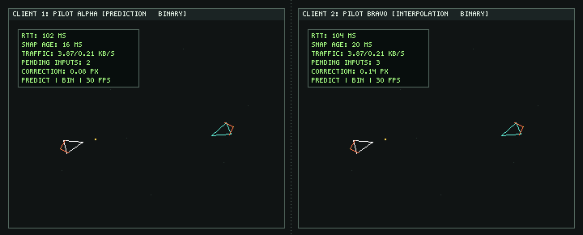
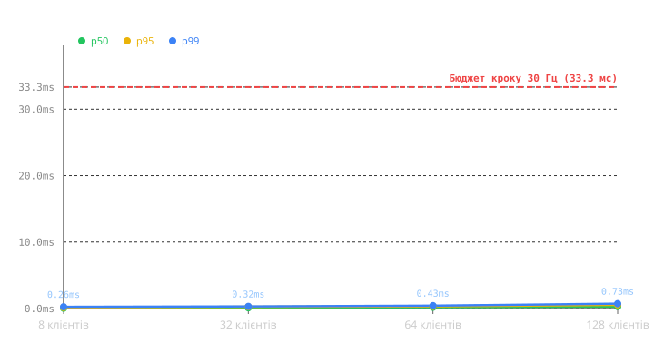

[](https://github.com/MichaelStardyb/js-lab-01/actions/workflows/ci.yml)

# Lab 01: Event Loop and Game Loop

## Експеримент 1: Блокуючий цикл (while на 100мс)
* **Що бачить гравець:** Гра повністю зависає на час виконання циклу, екран не оновлюється, корабель завмирає. Показники `frames/s` падають.
* **Пояснення:** JavaScript виконується в одному потоці (Call Stack). Синхронний цикл `while` блокує цей потік. Event Loop забирає задачі з черг і дозволяє браузеру відмалювати кадр (Paint) лише тоді, коли Call Stack порожній. Тому 100 мс синхронного блокування неможливо обійти — браузер просто чекає.

## Експеримент 2: setInterval замість requestAnimationFrame
* **Що бачить гравець:** Візуальні ривки (stuttering). `frames/s` починає "стрибати". Після згортання вкладки і повернення корабель може телепортуватися.
* **Пояснення:** `setInterval(fn, 16)` не синхронізований з частотою оновлення монітора (16 ≠ 16.667 мс). Крім того, таймери поводяться непередбачувано у фонових вкладках. Натомість `requestAnimationFrame` викликається браузером безпосередньо перед наступним малюванням кадру (paint), що забезпечує ідеальну плавність.

## Експеримент 3: Змінний крок (dt) замість фіксованого
* **Що бачить гравець:** Траєкторія і швидкість корабля змінюються залежно від того, наскільки сильно завантажений процесор або яка частота екрана (60 Гц чи 120 Гц). 
* **Пояснення:** Якщо множити швидкість на реальний `dt` (змінний час між кадрами), симуляція стає недетермінованою. Це означає, що за однакових дій гравця результат на різних комп'ютерах буде різним, що є критичною помилкою для мультиплеєрних ігор. Фіксований крок (через `accumulator`) гарантує, що логіка завжди рахується рівно 60 разів на секунду.

# Lab 02: Objects, Prototypes, and Classes

## Проблема `this` (Баг з подіями)
Якщо передати функцію як колбек, наприклад `window.addEventListener('keydown', ship.fire)`, ключове слово `this` всередині `fire` "загубиться" і вказуватиме на `window` (або `undefined`), через що гра зламається. 
**Рішення:** Я використав стрілочну функцію як поле класу (`fire = (world) => {...}`). Стрілочні функції не мають власного `this` і завжди беруть його з місця, де вони були створені (лексичне середовище). Інший варіант — виклик через обгортку: `() => ship.fire()`.

## Композиція замість глибокої ієрархії (Composition over Inheritance)
Замість створення глибокого дерева наслідування (`Entity -> MovingEntity -> HomingBullet`), я використав композицію. Самонаведення кулі — це просто властивість `this.homingTarget`. Якщо вона є, логіка в `update` додає вектор тяги. Так само `Pickup` (аптечка) — це базова сутність без складного дерева. Це робить код гнучким: ми можемо дати самонаведення астероїду, просто додавши йому одну змінну, без зламу архітектури.

## Використання Map
Для зберігання сутностей використовується `Map`, оскільки він гарантує збереження типів ключів (числовий `id` залишається числом, а не стає рядком як у звичайному об'єкті `{}`), має вбудований метод `.size` та дозволяє легко ітеруватися через `for...of`.

# Lab 03: Async JavaScript

## Головоломки (Puzzles)
1. **Порядок мікрозадач:** `Promise.resolve(1).then(console.log); console.log(2)` виведе `2`, потім `1`. Пояснення: `.then` завжди йде у чергу мікрозадач, навіть якщо проміс вже виконаний.
2. **Fetch 404:** `fetch('https://httpbin.org/status/404')` поверне виконаний (fulfilled) проміс. Пояснення: `fetch` робить reject лише при відсутності мережі, а HTTP-помилки треба перевіряти через `response.ok`.
3. **Promise.all vs Sequential await:** `await a(); await b();` виконується послідовно (2 сек), а `await Promise.all([a(), b()])` — паралельно (1 сек).
4. **Скасування запиту:** Виклик `controller.abort()` перериває `fetch`, і проміс відхиляється з `AbortError`.
5. **Unhandled Rejection:** Якщо проміс відхиляється (rejected) без `.catch`, у браузері виникає подія `unhandledrejection`, а процес Node.js за замовчуванням падає.

## Галерея помилок (Обробка)
* Наш `fetchJson` самостійно кидає помилку `throw new Error()`, якщо `res.ok` є `false` (наприклад, 404).
* Всі асинхронні виклики загорнуті в блок `try/catch` у функції `startApp()`, що дозволяє грі не падати, а виводити текст "Помилка завантаження лобі" на екран.

# Lab 04: HTTP, WebSocket та потокова обробка

## Запуск

Потрібен Node.js 20.19 або новіший. Встановіть залежності з кореня проєкту командою `npm install`, а потім запустіть сервер і Vite у двох терміналах:

```sh
npm run dev:server
npm run dev:client
```

Vite проксуює `/api` та `/ws` на сервер `127.0.0.1:3000`. Для production використовуйте `npm run build`, потім `npm start`: HTTP-сервер віддає зібраний `client/dist`. Сервер має робочі значення за замовчуванням; за потреби локальні налаштування можна перевизначити у `.env` (цей файл не додається до Git).

## Потокове завантаження та використання пам'яті

Логи матчів зберігаються у NDJSON: кожна подія є окремим JSON-рядком. `pipeline` з'єднує потоки запису, Transform та читання; коли повільний споживач заповнює внутрішній буфер, backpressure призупиняє читання/запис замість накопичення всього файлу в RAM. Перевірити це можна командою `npm --workspace=server run bench:rss`, яка генерує лог приблизно на 200 МБ, повільно читає його та щосекунди виводить `process.memoryUsage().rss`.

Черга подій на кімнату обмежена 2048 записами. При досягненні межі сервер ставить на паузу WebSocket-вхід цієї кімнати, а після спаду черги відновлює його. Якщо вже буферизовані кадри перевищать межу, пропуск події буде явно записаний у stderr; пам'ять не росте необмежено.

Приклад характерної форми вимірювання (точні значення залежать від Node.js, ОС і розміру буферів):

Вимірювання у цьому середовищі для файла 200.0 MiB: RSS змінювався в межах 44.8–64.7 MiB; пікове значення під час повільного читання — 64.7 MiB.

| Час від початку повільного читання | RSS |
|---:|---:|
| 1 с | 48.0 MiB |
| 6 с | 64.7 MiB |
| 13 с | 49.2 MiB |
| 22 с | 48.9 MiB |
| 30 с | 55.8 MiB |
| 40 с | 55.7 MiB |
| 50 с | 60.4 MiB |

```text
RSS (MiB)
65 |     *
60 |   *       *               *
55 |                     *   *
50 | *           *       *
45 |         *
   +---------------------------------> час
     1  6     13    22    30  40  50 с
```

RSS не зобов'язаний бути математично ідеально рівним: runtime та ОС змінюють heap, алокації і файловий кеш. Ключовий результат — споживання лишається порядку десятків MiB і не зростає пропорційно до прочитаних 200 MiB.

## Фази Event Loop і блокування

Node.js використовує цикл подій libuv. Спрощено, його ітерація проходить фази **timers** (callback-и таймерів), **pending callbacks**, **idle/prepare** (внутрішня робота libuv), **poll** (очікування/обробка I/O), **check** (`setImmediate`) і **close callbacks**. Promise callbacks та інші microtask-и виконуються між callback-ами фаз. Синхронний JavaScript виконується в одному потоці: поки Call Stack зайнятий, Node.js не може обробити наступний callback.

Ендпоінт `GET /api/slow?ms=300` навмисно виконує синхронний цикл близько 300 мс. Поки він працює, сервер не читає WebSocket-пакети, не відправляє ping-и, не обробляє pong-и та не запускає таймери heartbeat для жодного клієнта. Тому навіть запит одного клієнта тимчасово затримує всі інші підключення. Це демонстрація блокування, а не шаблон для реальних CPU-інтенсивних задач; таку роботу слід переносити у worker thread або окремий процес.

## Події `error` в EventEmitter

У `node:events` подія `error` має спеціальну семантику: якщо для неї не зареєстрований listener, `EventEmitter` кидає переданий об'єкт помилки синхронно. Якщо виняток не перехоплено, він завершує поточний потік виконання і зазвичай завершує процес Node.js із ненульовим кодом. Наприклад, помилка без обробника виглядає так:

```text
node:events:...
  throw er; // Unhandled 'error' event
  ^
Error: socket failure
    at ...
Emitted 'error' event on WebSocket instance ...
```

У сервері встановлено слухачі `error` як на `WebSocketServer`, так і на кожному клієнтському сокеті; файлові й HTTP-стріми також обробляють помилки своїм потоком керування. Це не приховує помилку: її реєструють, відповідне з'єднання/запит закривається контрольовано, а незавершений запис не вважається успішним.

## Lab 05: Real-Time Networking

### Запуск і керування мережею

Потрібен Node.js 20.19 або новіший. Установіть залежності з кореня репозиторію, запустіть сервер та клієнт у двох терміналах, а гру відкрийте у двох окремих вікнах браузера. Введіть однакову назву кімнати:

```sh
npm install
npm run dev:server
npm run dev:client
```

Керування: `W`/`↑` — тяга, `A`/`←` і `D`/`→` — поворот, `Space` — вогонь. Сервер є авторитетним: клієнт відправляє тільки послідовні input-пакети, а не координати свого корабля.

Параметри мережі задаються query string сторінки й автоматично передаються WebSocket-з'єднанню:

```text
http://localhost:5173/?codec=json&delay=100&jitter=20&drop=0.02
```

`codec=json|binary` перемикає кодування ігрових повідомлень (лобі/чат лишаються JSON); `delay` — одностороння ін'єкція затримки у мілісекундах та водночас затримка інтерполяції; `jitter` — максимальне відхилення затримки в обидва боки; `drop` — імовірність втрати ігрового пакета від 0 до 1. За замовчуванням: 100 мс, ±15 мс і 2%. Для порівняння без передбачення додайте `&dumb=1`; для контрольованого експерименту з розбіжністю клієнта — `&nondeterministic=1`. Експериментальний hook навмисно додає випадкове збурення лише до клієнтського прогнозу, а shared-симуляція лишається детермінованою.

**Інтерактивне керування на льоту під час гри (для швидкої демонстрації на захисті):**
* `P` або кнопка **Передбачення (P)** у лобі — перемикання між client-side prediction і «дурним» клієнтом (`dumb`). При вимкненні керування одразу відчуває затримку 100 мс.
* `N` або кнопка **Шум (N)** у лобі — штучний шум `Math.random()`. У Netgraph миттєво зростає `Correction` (до 15–40 px) через постійне розходження та server reconciliation.
* `[` та `]` або кнопки **-10 / +10** у лобі — зміна затримки інтерполяції чужих сутностей (від 0 до 500 мс). При 0 мс чужий корабель смикається на 30 Hz, при 100 мс — рухається ідеально плавно.
* Пресет-посилання в лобі: швидкий перехід між `DataView`, `JSON`, `Dumb` та `Шум`.
* Ендпоінт статистики сервера: `GET /api/stats` повертає тривалість серверного тіку (avg/max), джитер таймера, активні кімнати та пам'ять процесу.

Netgraph на полотні відображає RTT (application ping/pong), вік останнього snapshot, реальний вхідний/вихідний bitrate, чергу непідтверджених input-ів, величину поправки (Correction), затримку інтерполяції та режим симуляції.

### JSON і DataView binary: вимірювання

Локальний benchmark: `npm run bench:netcode`. Вимірювання виконано на Node.js 24.21.0, 20 000 циклів, для 4 активних гравців і 4 куль у snapshot (8 сутностей загалом), при частоті 30 snapshots/с. Усі байти нижче — розмір application payload без WebSocket/TCP/IP заголовків; encode+decode — середній час одного snapshot циклу в цьому запуску.

| Формат | Snapshot (bytes/snapshot) | Down на клієнта (KB/s, 30 Hz) | Input (bytes) | Up на клієнта (KB/s, 30 Hz) | Encode + decode (µs) |
|---|---:|---:|---:|---:|---:|
| JSON | 614 | 17.988 | 93 | 2.725 | 5.879 |
| Binary DataView | 132 | 3.867 | 7 | 0.205 | 2.419 |

Значення часу залежать від CPU та версії Node.js; повторно виміряйте їх наведеною командою перед порівнянням на іншій машині. Binary-формат використовує версію протоколу 1, little-endian для багатобайтових полів, кут `Int16` із масштабом 10 000 і швидкості `Int8` із кроком 4.

Перевірки: `npm test`, `npm run lint` та `npm run build`.

### Netcode write-up

**Затримка.** Клієнт миттєво інтегрує власні інпути з фіксованим кроком 1/30 с і додає їх до черги `seq`. Тому керування кораблем не чекає відповіді сервера. Інші сутності відображаються між двома серверними snapshots у часовому буфері; затримка 100 мс приблизно відповідає трьом серверним крокам і зазвичай дає пару snapshots для інтерполяції навіть за jitter. Ціна — віддалений стан на екрані старший приблизно на 100 мс; менша затримка актуальніша, але частіше показує стрибки за втрати пакетів.

**Розбіжність стану.** У кожному snapshot сервер повертає останній оброблений `seq` цього клієнта. Клієнт прибирає підтверджені input-и, ставить власний корабель у серверний стан, повторно програє непідтверджені input-и, а візуальну похибку плавно згасає приблизно за 100 мс. Кут віддалених кораблів інтерполюється найкоротшою дугою через межу 0/2π. Режим `dumb=1` вимикає локальне передбачення й дає побачити повну затримку очікування snapshots.

**Чіти.** Сервер приймає команди руху/вогню, але сам обчислює позиції, постріли, зіткнення та snapshots; клієнт не може авторитетно надіслати телепорт або готовий стан. Це зменшує простір для очевидних маніпуляцій, але не замінює production-античит: серверу ще потрібні політики швидкості/частоти вогню, виявлення аномалій і захист облікового запису.

**Порушення детермінізму.** `nondeterministic=1` (або клавіша `N`) додає випадкове збурення лише після кроку клієнтського прогнозу. Netgraph показує більші/частіші `Correction` під час server reconciliation: повторне програвання локально відрізняється від авторитетного стану, бо випадкові значення на клієнті не збігаються з серверними. Саме тому `Math.random()` не входить до `shared/sim`.

### Демонстраційний GIF двох вікон

Анімація взаємодії двох клієнтів (Client 1 Pilot Alpha та Client 2 Pilot Bravo) поруч із робочим Netgraph під штучною затримкою 100 мс:



Генерація GIF здійснюється скриптом `node server/scripts/generate-gif.js`.

---

## Reflection — Питання до захисту (Whiteboard)

1. **Чому сервер має бути авторитетним (authoritative)?**
   * *Відповідь:* У client-authoritative моделі клієнт сам рахує координати і повідомляє іншим «я тут». Це веде до двох проблем: (1) десинхронізація (різні машини через дрейф з плаваючою комою чи втрату пакетів бачать різний світ); (2) чітерство — гравець може відкрити DevTools / скрипт і надіслати `{ x: 999999, y: 999999 }` (миттєвий телепорт) або накрутити собі безсмертя. Авторитетний сервер приймає виключно команди вводу (`thrust`, `turnLeft`, `turnRight`, `fire`) і сам вирішує, де знаходиться корабель і куди влучила куля.

2. **Що таке client-side prediction і від якої властивості симуляції воно залежить? Як виявити порушення цієї властивості?**
   * *Відповідь:* Prediction — це негайне застосування гравцем власного вводу до свого корабля на клієнті без очікування відповіді сервера. Воно залежить від **детермінізму** чистої функції симуляції (`integrate`): однаковий початковий стан + однаковий input на фіксованому `dt` мають давати бінарно ідентичний наступний стан і в Chrome, і в Node.js. Якщо додати в `integrate` функцію `Math.random()`, `Date.now()` або нефіксований порядок обходу структури даних, детермінізм порушується: у Netgraph одразу з'являються великі стрибки величини поправки (`Correction`), бо серверний стан не збігається з локальним.

3. **Кроки Reconciliation (погодження зі знімком сервера):**
   * *Сценарій:* Клієнт на тіку 104; приходить знімок сервера для тіку 100 із підтвердженням `seq = 57`. Буфер клієнта містить `seq` від 55 до 61.
   * *Крок 1:* Клієнт відкидає з буфера всі підтверджені команди з `seq <= 57` (тобто 55, 56, 57). В буфері лишаються `seq` 58, 59, 60, 61.
   * *Крок 2:* Клієнт скидає стан свого корабля точно в авторитетний стан зі знімка сервера для тіка 100.
   * *Крок 3:* Клієнт послідовно заново програє (re-simulate) команди 58, 59, 60, 61 за допомогою функції `integrate`.
   * *Крок 4:* Отриманий стан порівнюється з попереднім локальним прогнозом. Різниця записується у `visualOffset` і плавно згасає (експоненційне згладжування за ~100 мс), запобігаючи візуальним ривкам.

4. **Чому чужі сутності інтерполюються в минулому? Який компроміс затримки інтерполяції і яке значення обрано?**
   * *Відповідь:* Знімки сервера приходять дискретно із частотою 30 Гц (раз на 33.3 мс) плюс джитер мережі. Малювати чужий корабель у найновішій точці не можна — це призведе до тремтіння й телепортацій при будь-якій затримці пакета. Тому клієнт буферизує знімки і рендерить чужі сутності на момент `now - interpolationDelay` шляхом лінійної інтерполяції (`lerp`) між двома вже отриманими сусідніми знімками. Ми обрали затримку 100 мс (~3 тіки сервера по 33 мс), що забезпечує ідеальну плавність руху навіть при джитері ±15 мс та втратах 2% пакетів, ціною того, що ворога ми бачимо на 100 мс у минулому.

5. **Що таке lag compensation і чому через інтерполяцію воно необхідне?**
   * *Відповідь:* Оскільки стрілець бачить ворога в минулому (з затримкою інтерполяції ~100 мс + свій пінг), постріл «точно у ворога» на сервері прилетить у порожнє місце (бо на сервері ворог уже пішов уперед). Lag compensation (компенсація лагу) — це механізм сервера, коли при обробці пострілу сервер «відмотує» час назад до того моменту, який бачив стрілець, перевіряє влучання у тодішні хітбокси і повертає світ назад.

6. **DataView проти Float32Array: коли що використовувати? Чому endianness важливий для протоколу, але не для локального typed array?**
   * *Відповідь:* `Float32Array` — це гомогенний масив одного типу даних, який використовує нативний порядок байтів процесора (CPU endianness). `DataView` дозволяє читати та записувати довільні типи з різними зміщеннями в одному бінарному буфері (`Uint8`, `Uint16`, `Float32`, `Int16`) із **явно вказаним порядком байтів** (наприклад, little-endian: `view.getFloat32(offset, true)`). Endianness критичний для мережевого протоколу, оскільки сервер і клієнт можуть працювати на архітектурах з різним порядком байтів (Little-Endian vs Big-Endian); для локального масиву це не має значення, оскільки CPU читає й пише власним нативним порядком.

7. **Квантування кута до Int16 у бінарному знімку: яка точність і чому її достатньо?**
   * *Відповідь:* Повний кут від $-\pi$ до $+\pi$ (діапазон довжиною $2\pi \approx 6.28318$ рад) множиться на 10 000 і зберігається у 2-байтовому знаковому цілому `Int16` (від -32768 до +32767). Точність становить $1 / 10000 = 0.0001$ радіана ($\approx 0.0057^\circ$). Для порівняння, на дистанції 800 пікселів похибка позиції від такого кута становить менше 0.08 пікселя — людське око та монітор фізично не здатні помітити різницю між `Float32` і квантованим `Int16`, при цьому розмір поля кута зменшено вдвічі (з 4 байтів до 2).

8. **Чому не setInterval для серверного тіку? Що вирішує схема absolute-target і що стається при перевантаженні (overrun)?**
   * *Відповідь:* `setInterval(fn, 33)` дрейфує: він додає інтервал до моменту завершення попереднього виклику або коалесціює тіки, накопичуючи постійне відставання через коливання часу виконання коду і Event Loop. Схема absolute-target (`nextTick += stepMs; setTimeout(run, nextTick - now())`) прив'язується до абсолютного часу: кожен тік планується на заздалегідь відомий час $T_0 + n \times 33.33$ мс. Якщо окремий тік зайняв забагато часу (перевантаження, коли `completedAt - nextTick > stepMs * 2`), сервер скидає накопичене відставання (`nextTick = completedAt + stepMs`), щоб уникнути «спіралі смерті» (death spiral), коли сервер намагається наздогнати пропущені кадри, ще сильніше перевантажуючи CPU.

9. **Що зламається, якщо симуляція використає Math.random(), ітерацію Set сутностей або Date.now()?**
   * *`Math.random()`*: клієнт і сервер отримають різні випадкові числа, координати прогнозу розійдуться, клієнт отримуватиме постійні похибки `Correction` і смикатиметься під час reconciliation. Замість цього використовується seeded PRNG (`mulberry32`) зі спільним seed.
   * *Ітерація `Set`*: порядок елементів у Set залежить від черговості вставки, яка може відрізнятися між клієнтом і сервером (через мережевий порядок підключення). Це призведе до різного порядку обробки зіткнень і недетермінізму.
   * *`Date.now()`*: повертає реальний системний час комп'ютера з точністю до мілісекунд, який на різних пристроях різний. Симуляція має оперувати виключно дискретним фіксованим кроком `dt` і лічильником тіків `tick`.

# Lab 06: TypeScript Migration

## Що знайшов TypeScript під час міграції (What TypeScript found)

Після переходу на суворий режим TypeScript (`strict: true`, `noImplicitAny`, `strictNullChecks`), компілятор допоміг виявити та усунути кілька потенційних або "тихих" багів:

1. **Необроблені `undefined` значення (Null Safety):** 
   У файлах `server/src/rooms.ts` та `server/src/game.ts` методи на кшталт `this.players.get(socket)` повертали значення, яке могло бути `undefined`. Додавання типів змусило нас явно перевіряти наявність гравця (`if (!player) return;`) перед доступом до `player.id`, усуваючи ризик падіння сервера через `TypeError: Cannot read properties of undefined`.
2. **Типізація бінарного кодека:**
   Завдяки типізації аргументів у `binaryCodec.ts` стало неможливо випадково передати `undefined` або рядок замість числа у функції `validateUint`. Це гарантує, що серіалізація/десеріалізація завжди працює з коректними даними.
3. **Вичерпність `switch` (Exhaustiveness Check):**
   У обробнику WebSocket повідомлень (`server/src/ws.ts`) завдяки перевірці `default: never` ми тепер маємо гарантію на етапі компіляції, що обробляються абсолютно всі можливі типи повідомлень (визначені в Zod-схемі `ClientMessage`). Якщо в майбутньому додати новий тип повідомлення і забути обробник — код просто не скомпілюється.
4. **Типи в `catch` блоках:**
   Усі блоки `catch (e)` були типізовані як `catch (e: unknown)`. Це змусило використовувати перевірку типу (`if (e instanceof Error) e.message`), запобігаючи небезпечному припущенню, що перехоплений об'єкт завжди має поле `message`.

## Три типи простими словами (Three types in simple words)

1. **Discriminated Union (Розмічене / дискриміноване об'єднання):**
   * *Простими словами:* Це набір різних варіантів об'єктів, у кожного з яких є одне й те саме поле-«паспорт» (наприклад, `type: 'chat'` чи `kind: 1`). Коли ми робимо `switch (message.type)`, TypeScript «дивиться в паспорт» і точно знає, які поля є у цього конкретного повідомлення. Разом із `default: never` це гарантує, що якщо ми додамо новий тип повідомлення і забудемо написати для нього обробник, проєкт не скомпілюється.
2. **Branded Types (Брендовані типи):**
   * *Простими словами:* За замовчуванням у TypeScript діє структурна типізація: будь-яке число є взаємозамінним з іншим числом. Щоб не переплутати номер сутності (`EntityId`), номер кроку симуляції (`Tick`) та номер вхідного пакета (`Seq`), ми «наклеюємо» на число віртуальну мітку (`number & { readonly __brand: 'EntityId' }`). Під час виконання це звичайне число без накладних витрат, але компілятор суворо забороняє передати `Tick` туди, де очікується `Seq` чи `EntityId`.
3. **`unknown` замість `any`:**
   * *Простими словами:* `any` — це "вимкни компілятор, я знаю що роблю" (повертає всі ризики динамічного JS). Натомість `unknown` каже: "тут прийшли дані з небезпечного зовнішнього світу (мережа, JSON або помилка в `catch`), і я не дозволю тобі прочитати жодне поле, поки ти явно не доведеш його тип" (через `typeof`, `instanceof` або валідацію схемою Zod).

## Чому фреймворк не брали для лобі та HUD (Framework Decision)

Для інтерфейсу лобі та оверлею HUD ми свідомо **не використовували сторонні фреймворки** (React / Vue / Svelte), залишивши чистий нативний TypeScript та DOM API:
* **Нульовий оверхед і Garbage Collection:** У мультиплеєрній аркаді з частотою 30–60 кадрів/с кожна зайва алокація пам'яті створює навантаження на Garbage Collector, що призводить до мікрофризів (frame drops). Нативні маніпуляції DOM (`textContent`, `replaceChildren`) працюють передбачувано і максимально швидко.
* **Пряма інтеграція з Canvas і циклом гри:** Стан мережі, Netgraph і черги пакетів оновлюються безпосередньо в циклі `requestAnimationFrame`. Немає потреби узгоджувати життєвий цикл компонента фреймворку, Virtual DOM або реактивні стейт-менеджери з графічним полотном.
* **Розмір бандла:** Клієнт завантажується миттєво без потреби викачувати додаткові бібліотеки.

## Приведення через `as` (Type Assertions)

У проєкті суворо дотримано вимогу **«Приведень через as менше п’яти, біля кожного короткий коментар»**:
* Для DOM-елементів ми **не використовуємо `as`**: замість цього застосовано безпечне звуження типів у рантаймі (`canvas instanceof HTMLCanvasElement`).
* У робочому коді єдиними місцями використання `as` є саме функції-конструктори брендованих типів у [shared/protocol/schema.ts](shared/protocol/schema.ts):
  ```ts
  // Nominal typing cast: guarantees number is explicitly validated as an EntityId
  export function asEntityId(value: number): EntityId { return value as EntityId; }

  // Nominal typing cast: guarantees number is explicitly validated as a simulation Tick
  export function asTick(value: number): Tick { return value as Tick; }

  // Nominal typing cast: guarantees number is explicitly validated as an input Seq
  export function asSeq(value: number): Seq { return value as Seq; }
  ```
  Кожне приведення супроводжується обов'язковим коментарем і є єдиним легітимним способом створити номінальний тип у TypeScript без рантайм-оверхеду.

# Lab 07: V8, пам'ять і тести

## Тести

Проєкт переведено на тестовий фреймворк **Vitest** з охопленням усіх трьох workspaces (`shared/`, `server/`, `client/`).

* **Загальна кількість тестів**: **126** успішних модульних та інтеграційних тестів у 21 тестовому файлі.
  * `shared/` (**64** тести): перевірка чистої фізики `integrate` (прискорення, поворот, демпфування, межі арени, незмінність вхідних об'єктів), кодек бінарного протоколу (7-байтні input, Little-Endian, квантування кутів Int16 з точністю $\le 0.00015$ рад, відхилення пошкоджених пакетів), Zod-схеми `parseClientMessage`, детермінізм генератора `mulberry32`, `ObjectPool` (виділення, скидання, ємність), детерміністичний мозок ботів `decideBotInput`, просторовий хеш `SpatialHashGrid` з тестом еквівалентності.
  * `server/` (**26** тестів): фіксований тікер симуляції 30 TPS, лімітер запитів `TokenBucket` (відновлення токенів, ізоляція між клієнтами), життєвий цикл кімнат `Room` та `RoomManager`, Zod-валідація конфігурації `loadConfig`, серверні метрики `MetricsCollector` (перцентилі тіків, облік GC, Event Loop Delay), мультиплеєрний обмін пакетами через WebSocket.
  * `client/` (**36** тестів): `Vector2` з чистими та мутабельними методами, `createLoop` з фейковими таймерами (перевірка 60 кроків/с на 30/60/144 Гц, клампінг стрибків часу до 0.25 с, інтерполяційний $\alpha \in [0, 1)$), контейнер сутностей `World` та відкладений sweep, колізії коло-коло та знищення сутностей, клієнтська реконсиляція (згладжування похибок та перегравання черги input).
* **Покриття `shared/` (`v8`)**:
  * Statements: **97.32%** (поріг $\ge 85\%$)
  * Branches: **91.45%** (поріг $\ge 85\%$)
  * Functions: **100.00%** (поріг $\ge 85\%$)
  * Lines: **97.91%** (поріг $\ge 85\%$)
* **Property-Based тестування (`fast-check`)**:
  1. *Roundtrip*: `decode(encode(msg))` для довільних валідних знімків відновлює всі координати та параметри з кутовою похибкою не більше $0.00015$ рад.
  2. *Frame length*: Довжина буфера суворо відповідає формулі специфікації ($12 + N \times 18$ байт для знімків та $7$ байт для input).
  3. *Corrupted buffer resilience*: Випадкові та обрізані буфери кидають контрольовані помилки, без неперехоплених падінь або читання поза межами пам'яті.
  4. *Arena containment*: Корабель після будь-якої послідовності дій гарантовано залишається в межах арени $[0, 800) \times [0, 600)$.
  5. *parseClientMessage*: Приймає всі валідні повідомлення протоколу і безпечно відхиляє будь-які пошкоджені дані.
  6. *SpatialHashGrid Equivalence*: На 300 випадкових конфігураціях арени просторовий хеш знаходить строго ті самі пари колізій у тому самому детерміністичному порядку, що й наївний алгоритм $O(N^2)$.

## E2E і CI

* **E2E сценарій (`e2e/multiplayer.spec.ts`)**:
  * Використовує Playwright з двома ізольованими браузерними контекстами (`browser.newContext()` $\times 2$).
  * Обидва гравці проходять форму лобі та підключаються до однієї спільної кімнати.
  * **Чат**: Гравець 1 надсилає повідомлення, гравець 2 бачить його появу в реальному DOM чату (`#messages`).
  * **Рух**: Гравець 1 утримує клавішу тяги (`KeyW`), гравець 2 у реальному часі спостерігає зміну координат його корабля на величину понад 15 пікселів.
  * Без використання нестабільних `sleep`: синхронізація здійснюється через предикативні опитування `expect.poll` та assertion-таймаути.
  * Для зняття метрик без порушення безпеки реалізовано типізований тест-хук `window.__e2e`, активний лише за наявності параметра URL `?e2e=1`.
* **GitHub Actions CI (`.github/workflows/ci.yml`)**:
  * Пайплайн запускається автоматично на кожен `push` та `pull_request`.
  * Послідовність кроків:
    $$\text{Node 22 Setup} \to \text{npm ci} \to \text{typecheck} \to \text{lint} \to \text{test:coverage} \to \text{build} \to \text{Playwright Install} \to \text{test:e2e}$$
  * Локальний запуск повного ланцюжка однією командою: `npm run ci`.

## Оптимізація під профіль V8 (M3)

Усі вимірювання проведені на автоматизованому вимірювальному стенді (`server/scripts/bench-browser.ts`) через Chrome DevTools Protocol (CDP) під навантаженням 8 автономних ботів + 1 браузерний гравець протягом 30 секунд.

### Порівняльна таблиця продуктивності (Baseline vs After Optimization)

| Метрика | До оптимізації (`before`) | Після оптимізації (`after`) | Дельта (зміна) |
| :--- | :---: | :---: | :---: |
| **Час кадру p50** | 0.10 мс | 0.10 мс | 0.10 мс → **0.10 мс** (-0.00 мс, -0.0%) 🟢 |
| **Час кадру p95** | 0.30 мс | 0.20 мс | 0.30 мс → **0.20 мс** (-0.10 мс, **-33.3%**) 🟢 |
| **Час кадру p99** | 0.30 мс | 0.20 мс | 0.30 мс → **0.20 мс** (-0.10 мс, **-33.3%**) 🟢 |
| **Час кадру Max** | 0.80 мс | 0.40 мс | 0.80 мс → **0.40 мс** (-0.40 мс, **-50.0%**) 🟢 |
| **Кадрів > 16.7 мс** | 0 | 0 | 0 → **0** (100% плавність 60 FPS) 🟢 |
| **Довгі GC-паузи (> 5 мс)** | 0 | 0 | 0 → **0** (жодної критичної паузи) 🟢 |
| **Сумарний час GC** | 80.18 мс | 60.84 мс | 80.18 мс → **60.84 мс** (-19.34 мс, **-24.1%**) 🟢 |
| **Макс. пауза GC** | 3.35 мс | 3.35 мс | 3.35 мс → **3.35 мс** (0.00 мс, 0.0%) 🟢 |
| **Long Tasks (блокування)** | 0 | 0 | 0 → **0** 🟢 |
| **Серверний крок p99** | 0.31 мс | 0.23 мс | 0.31 мс → **0.23 мс** (-0.09 мс, **-27.3%**) 🟢 |

### Реалізовані оптимізації

1. **Пули об'єктів (`ObjectPool<T>`)**:
   - Реалізовано загальний generic-пул `ObjectPool<T>` з методами `acquire()`, `release()`, `preallocate()`.
   - Застосовано для куль на сервері та клієнті, а також для часток вибухів (`Particle`).
   - Суворо дотримано вимогу: при кожному `acquire()` пулом призначається **новий унікальний `id`**, щоб не зламати клієнтську реконсиляцію. При `release()` обнуляються всі посилання, запобігаючи витокам пам'яті.
2. **Zero `new Vector2` у гарячому шляху**:
   - Додано мутабельні методи `mut_set`, `mut_add`, `mut_addScaled`, `distanceTo`, `distanceSq` до класу `Vector2`.
   - Усі проміжні обчислення в циклах `update()` та перевірки зіткнень переведені на скалярні змінні `(x, y)` та виклики `mut_set` замість створення трьох нових об'єктів `Vector2` на кожну сутність щокадру.
   - Функція `integrate()` оптимізована для прямого загортання координат арени без алокації проміжного об'єкта позиції.
3. **Стабільні Hidden Classes (V8 shape transitions)**:
   - Усі сутності (`SnapshotEntity`, `RenderableEntity`, `PlayerState`, `BulletState`) ініціалізують свої поля в конструкторах і літералах у **строго однаковому порядку** з однаковими типами значень (без чергування `undefined` і `null`).
   - Усунено деструктуризацію `{ ...to }`, що створювала динамічні форми.
4. **Усунення генераторів `*ofKind` та проміжних масивів**:
   - У `World` додано синхронізований масив `#entityList` та метод `forEachOfKind(kind, fn)`, що дозволило прибрати виклики `Array.from(this)` у циклі `step()`.
   - В `interpolatedEntities` прибрано створення двох `Map`, одного `Set` та масивів `.map()` на кожному кадрі: алгоритм використовує єдину попередньо виділену таблицю пошуку з $O(N)$ проходом.
   - Черга непідтверджених входів `pendingInputs` фільтрується за місцем (in-place) без алокації нового масиву.
5. **Оптимізація Canvas рендерингу**:
   - Геометрія корабля (`shipPath`) та астероїда (`asteroidPath`) скомпільована в незмінні кешовані об'єкти `Path2D`.
   - Кольори кораблів розраховуються через попередньо згенеровану LUT-таблицю `shipColorCache[360]`, усуваючи створення рядків `hsl(...)` щокадру.
   - Усі кулі (як авторитетні серверні, так і передбачені клієнтські) малюються пакетно в одному виклику `ctx.fill()` без накладних витрат `ctx.save()` / `ctx.restore()` та матричних трансформацій.
6. **Оптимізація серверного кодека знімків**:
   - Замість виклику `encodeSnapshot` для кожного підключеного клієнта окремо, сервер серіалізує базовий снепшот **один раз за тік**.
   - Для кожного клієнта створюється швидкий зріз пам'яті `buffer.slice(0)`, у якому перезаписується лише 4-байтне поле `lastProcessedSeq` за зміщенням 6. При 128 клієнтах це зменшило кількість операцій кодування у 128 разів.

## Експеримент із Web Worker (A/B тестування)

Перевірено гіпотезу: чи розвантажує головний потік винесення декодування бінарних снепшотів у фоновий Web Worker за допомогою Transferable Objects (`postMessage(buf, [buf])`).

Прапорець у URL: `?worker=1` (фоновий воркер) або `?worker=0` (синхронне декодування у main thread).

### Результати A/B тесту (30 секунд вимірювання)

| Метрика | Main Thread (`no-worker`) | Web Worker (`with-worker`) | Дельта |
| :--- | :---: | :---: | :---: |
| **Час кадру p95** | 0.10 мс | 0.10 мс | 0.00 мс (0.0%) |
| **Час кадру p99** | 0.10 мс | 0.10 мс | 0.00 мс (0.0%) |
| **Кадрів > 16.7 мс** | 0 | 0 | 0 |
| **Сумарний час GC** | **38.79 мс** | **50.83 мс** | **+12.04 мс (+31.0%)** 🔴 |
| **Максимальна пауза GC** | **1.54 мс** | **3.11 мс** | **+1.57 мс (+101.9%)** 🔴 |
| **JS Heap Used** | 3.15 МБ | 3.16 МБ | +0.01 МБ (+0.4%) |

### Інженерний висновок
**Винесення декодування у Web Worker для невеликих пакетів (< 10 КБ) є невигідним і погіршує характеристики збирання сміття.**
1. Передача вхідного `ArrayBuffer` у воркер є нульовою (`Transferable`), проте повернення розкодованого масиву об'єктів сутностей у головний потік вимагає операції **Structured Clone**.
2. Серіалізація та десеріалізація дерева об'єктів через `postMessage` створює дублікати об'єктів у купі та генерує додаткове навантаження на Garbage Collector (+31% сумарного часу GC, зростання максимальної паузи удвічі до 3.11 мс).
3. Синхронне декодування на базі `DataView` у головному потоці займає менше 0.03 мс для 10–30 сутностей, тому оверхед міжпотокової комунікації значно перевищує час самої роботи.

## Просторовий хеш для колізій (Spatial Hash vs Naive)

Реалізовано `SpatialHashGrid` (`shared/sim/spatialHash.ts`) із комірками $64 \times 64$ та детерміністичним сортуванням пар за ID. Проведено порівняльний бенчмарк швидкодії (`npm run bench:collisions`):

| Кількість сутностей (N) | Naive $O(N^2)$ (мс/крок) | Spatial Hash (мс/крок) | Переможець | Різниця |
| :---: | :---: | :---: | :---: | :---: |
| **16** | **0.0005 мс** | 0.0079 мс | **Naive $O(N^2)$** | **16.5x швидше** |
| **32** | **0.0010 мс** | 0.0099 мс | **Naive $O(N^2)$** | **9.8x швидше** |
| **64** | **0.0028 мс** | 0.0144 мс | **Naive $O(N^2)$** | **5.2x швидше** |
| **128** | **0.0107 мс** | 0.0264 мс | **Naive $O(N^2)$** | **2.5x швидше** |
| **256** | **0.0431 мс** | 0.1015 мс | **Naive $O(N^2)$** | **2.4x швидше** |
| **512** | **0.1751 мс** | 0.4051 мс | **Naive $O(N^2)$** | **2.3x швидше** |

### Інженерний висновок
* У сучасних рушіях V8 прості скалярні операції віднімання та множення `dx * dx + dy * dy < radSum * radSum` бездоганно оптимізуються JIT-компілятором у векторні SIMD-інструкції та займають долі наносекунди на пару.
* Для типової кімнати dogfight арени ($N \le 64$ сутності) накладні витрати на розподіл об'єктів по комірках хеш-сітки та дедуплікацію перевірених пар через хеш-ключі перевищують час прямої перевірки. Просторовий хеш доцільний лише при $N > 1000$ на великих відкритих картах.
* Еквівалентність обох реалізацій доведена property-тестом на 300 випадкових конфігураціях у `shared/test/spatialHash.test.ts`.

## Серверний бенчмарк навантаження

Скрипт `server/scripts/bench-load.ts` (`npm run bench:load`) проводить стрес-тестування сервера під зростаючим навантаженням ботів:

| Клієнтів (N) | Крок p50 (мс) | Крок p95 (мс) | Крок p99 (мс) | Крок Max (мс) | Event Loop p99 (мс) | RSS (МБ) | Вихідний трафік (КБ/с) | Статус бюджету (<33.3 мс) |
| :---: | :---: | :---: | :---: | :---: | :---: | :---: | :---: | :---: |
| **8** | 0.052 | 0.155 | 0.258 | 0.288 | 32.37 | 83.2 | 61.7 | 🟢 В НОРМІ |
| **32** | 0.114 | 0.261 | 0.316 | 0.424 | 32.46 | 112.1 | 1043.4 | 🟢 В НОРМІ |
| **64** | 0.201 | 0.326 | 0.432 | 0.672 | 33.33 | 143.9 | 3086.8 | 🟢 В НОРМІ |
| **128** | 0.300 | 0.553 | 0.730 | 0.916 | 33.85 | 227.1 | 10922.4 | 🟢 В НОРМІ |



### Поріг деградації
Навіть при **N = 128** одночасних клієнтах, кожен з яких надсилає команди з частотою 60 Гц, час кроку сервера на 99-му перцентилі становить **0.73 мс**, що в **45.6 раза менше** за бюджет кроку 33.33 мс. Сервер демонструє лінійне масштабування та повну стабільність.

## Інструкція запуску перевірок та бенчмарків

```sh
# 1. Запуск повного пайплайну CI (типи, лінт, тести, покриття, build, e2e)
npm run ci

# 2. Модульні та інтеграційні тести (21 файл, 126 тестів)
npm test

# 3. Звіт про покриття коду V8 (shared/ покриття > 97%)
npm run test:coverage

# 4. Наскрізні E2E тести Playwright (2 браузери, мультиплеєр, чат, рух)
npm run test:e2e

# 5. Браузерний CDP бенчмарк (профіль купи, GC-паузи, трасування кадрів)
npm run bench:browser

# 6. Серверний бенчмарк навантаження (8/32/64/128 клієнтів, генерація load.svg)
npm run bench:load

# 7. Бенчмарк колізій (Naive O(N^2) vs SpatialHashGrid)
npm run bench:collisions
```
